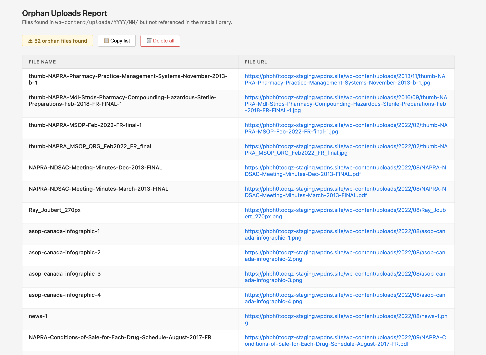
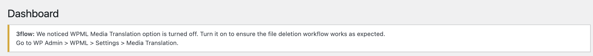

# Requirements
* WordPress 5.0+
* WPML (with **WPML Media Translation** enabled in settings)

## Diagnostic Dashboard

The plugin includes an admin diagnostic tool to audit and surface existing orphaned files:

## Dashboard Warning

The plugin throws a warning when WPML Media Translation isn't enabled in settings.

# What problem does it solve?
WordPress mu-plugin that fixes a known WPML edge case where deleted media attachments leave orphaned physical files behind in `wp-content/uploads/`. Includes an admin diagnostic tool to audit and surface existing orphans.

* **The Root Cause:** In certain scenarios—such as asynchronous metadata processing or translation record cleanup race conditions—WPML can "swallow" the native WordPress `wp_delete_file` filter. 
* **The Impact:** Because this filter is bypassed, the database records are wiped but the physical assets remain completely untouched, silently consuming and bloating the server's disk space over time. This plugin forces the `unlink` action at the lowest level to guarantee physical deletion.

# How to use it
Access `/wp-admin/?check_orphan_uploads=1` to run the scan and find/delete the orphan files.

> ⚠️ **Production Safety Note:** While the script targets verified orphans, it is highly recommended to perform a full backup of your `wp-content/uploads/` directory before executing a bulk physical deletion on live production environments.

# How to use it
Access `/wp-admin/?check_orphan_uploads=1` to run the scan and find/delete the orphan files.
